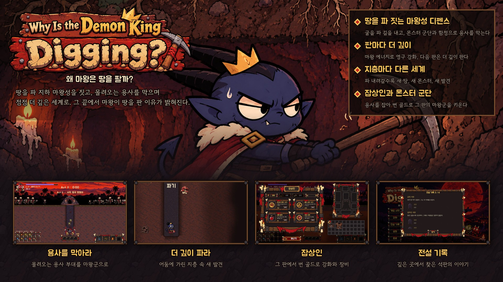
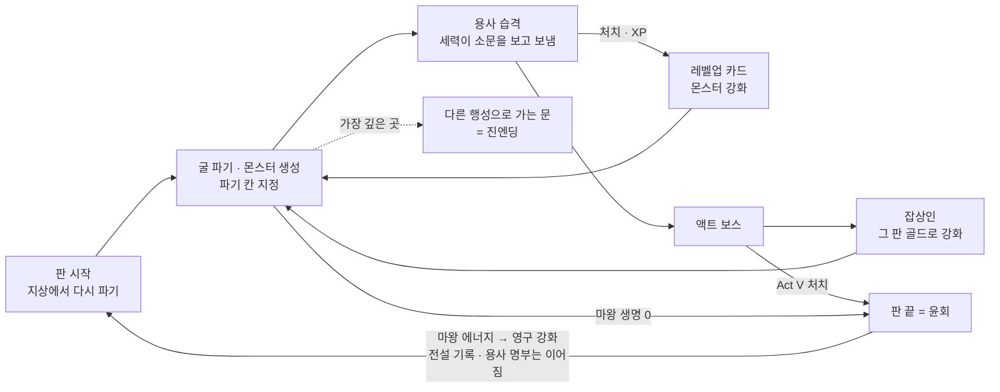
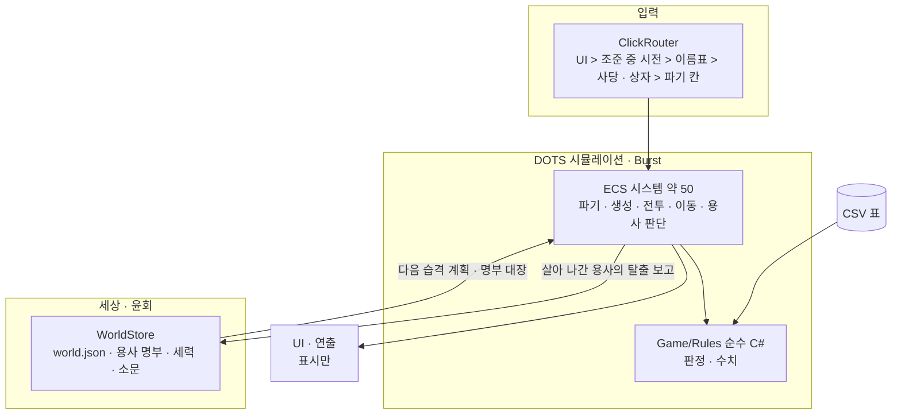

# ⛏️ Why Is the Demon King Digging? (왜 마왕은 땅을 팔까?)

> **Unity 6 · DOTS(Entities) 기반 2D 단면 던전 디펜스 × 세력 확장 로그라이트 — 마왕이 땅을 파 마왕성을 짓고, 몰려오는 용사를 막으며, 판을 거듭해 더 깊이 내려간다 (PC · 개발 중)**
> 기획 · 클라이언트 · QA 도구를 **1인 개발**하고, Claude Code 세션 팀(총괄 + 역할 7)과 GPT(Codex) · 생성 AI를 개발 파이프라인에 결합한 프로젝트

▶ **플레이 영상** — https://youtu.be/ZvOgHnrM9BY (2분 29초 · QA 도구로 자동 플레이 · 일부 구간 단축)


-1b2838)

| | |
|---|---|
| **장르** | 2D 단면 던전 디펜스 × 세력 확장 — 「D2 Survivors」의 서바이버 규칙을 땅속 단면 맵과 멈춘 마왕으로 옮겼다 |
| **플레이** | 싱글 · 판 기반(Act I~V · 한 판 30~40분). 판이 끝나면 **윤회** — 마왕은 영혼(영구 강화)과 기억(전설 기록)만 가져간다. 진엔딩까지 약 10시간이 목표 |
| **지금 단계** | 2단계(Act I~II) — 액트 2까지 한 판이 자동 검증을 통과한 지점. 재미는 아직 확인되지 않았다 |
| **개발 형태** | 1인 개발 + AI 세션 팀 (2026.10 ~ 진행 중 · 저장소 비공개) |
| **규모** | C# 430여 파일 · 약 6만 줄 · EditMode 시험 900여 개 · 게임 안 QA 훅 140여 개 · 자작 E2E 도구 gameqa |



---

## 1. 게임 개요

제목이 질문이고, 게임이 답이다.

마왕은 지하에 굴을 파 길을 내고 마왕성을 짓는다. 지상 입구로 쏟아져 내려오는 **용사 부대**는 마왕이 만들어 내는 **몬스터 군단**과 함정으로 막는다. 몬스터는 레벨업 때 고르는 카드로 강해진다.
판이 끝나면 마왕은 **윤회**한다. 세상은 그대로 이어지고, 마왕은 땅을 파다 모은 **마왕 에너지**로 영구 강화를 사서 다음 판엔 더 깊이 판다.
지층마다 다른 세계가 어둠에 가려 있다가 파면 드러난다. 다른 던전 · 유물 · 고대 몬스터 · 전설 석판이 그것이다. 가장 깊은 곳의 **「다른 행성으로 가는 문」**을 넘으면 진엔딩이다. 마왕이 땅을 판 이유는 세력을 다른 행성까지 넓히는 것이었다.

| 재화 | 얻는 곳 | 쓰는 곳 |
|---|---|---|
| **마왕 에너지**(영구) | 땅을 파다가 확률로 | 영구 강화(파기 힘 포함) |
| **골드**(그 판만) | 용사를 처치했을 때만 | 액트 사이에 오는 잡상인(강화 · 장비 · 물약 · 도박) |

**용사는 개인이다.** 이름 · 레벨 · 랭크 · 성격 특성 · 이력을 가진다.
- 세상은 **살아서 도망친 용사의 보고**로만 바뀌고, 세력들은 그 소문을 보고 다음 습격을 보낸다.
- 「후퇴」 · 「혼자 남아 막기」 · 「살아남아 더 강해져 돌아온 용사」 · 「고위험 던전이라는 소문」 · 「전생의 숙적」 같은 이야기는 기능으로 박지 않았다. 동기 · 두려움 · 무리 사기 · 기억의 **인과**에서 저절로 나오도록 설계했다.



---

## 2. 기술 스택

| 영역 | 사용 기술 |
|---|---|
| 엔진 | Unity 6000.5 · URP 17.6 · 2D(Animation · SpriteShape · Tilemap · Aseprite/PSD 임포터) · Input System 1.19 |
| 시뮬레이션 | DOTS — Entities 6.5 · Burst. 파기 · 전투 · 이동 · 용사 판단을 ECS 시스템 약 50개로 |
| 규칙 | 판정 · 수치는 순수 C#(`Game/Rules` 60여 파일)으로 분리 — 시스템은 규칙을 부르기만 한다 |
| 반응형 · 비동기 | R3 · UniTask |
| 데이터 | CSV → Info 클래스 코드 생성(밸런스 · 특성 · 세력 · 이름 · 별명 · 랭크 · 대사 표) |
| QA | NUnit EditMode · 게임 안 QA 서버(`Assets/GameQA`, JSON-RPC) + 자작 Python E2E 도구 `gameqa` · UI 자동 점검 · 인과 시뮬레이션 |
| 빌드 · 자동화 | Unity CLI(창 없는 에디터로 시험 · 빌드) |
| 그림 | 생성 AI(Codex 이미지) + 자작 2D 컷아웃 파이프라인(`tools/cutout`) · 자작 이펙트 공방(`tools/fx`, 웹 편집기) |
| 소리 | 생성 AI(ElevenLabs) + 후처리(`tools/audio`) |

---

## 3. 아키텍처

**ECS 시스템 + 순수 규칙** 두 층이다. 판정과 수치는 `Game/Rules`의 순수 C# 클래스에 두고, ECS 시스템은 데이터를 모아 규칙을 부르기만 한다. 그래서 규칙은 Unity 없이 EditMode 시험으로 확인한다.



| 규칙 | 내용 |
|---|---|
| 규칙은 순수 C# | `Game/Rules`는 씬 없이 돈다 — EditMode 시험이 판정 · 수치를 직접 확인한다 |
| 수치 · 글은 CSV | 밸런스와 용사 글 재료(특성 · 세력 · 이름 · 별명 · 랭크 · 말풍선 대사 · 습격 이유)는 CSV. 바꾸면 Info 클래스를 재생성한다 |
| 클릭은 한 곳에서 | `Input/ClickRouter`가 한 번의 클릭을 한 곳에만 준다 — 마법 조준 중에는 캐릭터 위를 눌러도 시전이 먼저다 |
| 세상은 보고로만 바뀐다 | 용사는 자기가 본 것과 세상 정보로만 판단하고, 세상 정보는 살아 나간 용사의 보고로만 바뀐다 |

용사 한 명의 판단 순서: 생성 → 관측 → 판단(무리는 0.5초마다 · 개인은 사건 때 재판단, 한 프레임 32명까지) → 행동 · 전투 · 이동 → 결과 → 사망 또는 탈출(탈출하면 보고를 남긴다).

---

## 4. 주요 시스템

| 시스템 | 구현 | 코드 |
|---|---|---|
| **파기 · 지층** | 마왕이 칸을 지정하면 몬스터가 파 준다. 깊을수록 단단하고, 파기 힘 단계가 더 깊은 구간을 연다. 지층마다 다른 땅 · 어둠 가림 · 깊이 이벤트 | `Input/DigTargetController.cs` · `Game/Ecs/Systems/{DigSystem, MonsterDigSystem, DepthZoneSystem, DepthEventSystem, FogSystem}.cs` |
| **몬스터 · 카드** | 몬스터 자동 생성 · 레벨업 카드 3장 중 하나로 몬스터 강화 · 함정 · 소환 | `MonsterSpawnSystem` · `MonsterCastSystem` · `TrapSystem` · `Game/Cards/` · `Game/Rules/CardRules.cs` |
| **경제 · 잡상인** | 마왕 에너지(영구) · 골드(그 판 · 용사 처치로만) · 액트 사이 잡상인 · 장비 · 물약 허리띠 | `Game/Economy/{EconomyDirector, MerchantService, BeltController}.cs` · `MerchantSystem` · `UI/Merchant/` |
| **용사 개인 · 판단** | 성격 특성 6 · 두려움 · 무리 사기 · 대장 재선출 · 행동 8가지 점수(전진 · 공격 · 엄호 · 후퇴 · 약탈 · 도주 · 함정 우회 · 땅 파기) · 세력 공용 위험 지도 | `Game/Ecs/Systems/{SquadDecisionSystem, HeroObserveSystem, HeroRejudgeSystem, HeroIntentApplySystem, FactionRiskFieldSystem}.cs` · `Game/Rules/{HeroDecideRules, HeroMoodRules, HeroTargetRules}.cs` |
| **세상 · 습격 · 윤회** | 탈출 보고 → 세상 정보 → 세력 관심 → 습격 계획 · 10초 예고 · 대장 등장. 용사 명부 120명 · 이름/별명/랭크 · 판을 넘어 이어지는 `world.json` | `Game/Hero/{WorldStore, WorldRules, HeroWorldBridge}.cs` · `HeroEscapeSystem` |
| **용사 화면** | 습격 예고 카드 · 이름표(숙적 > 이름 있는 대장 > 정예 > 생환자, 한 화면 최대 8) · 말풍선 · 정보창(일시정지) | `UI/Hero/` |
| **액트 · 보스** | 시계에 따라 액트 진행 · 정예 · 보스 | `ActDirectorSystem` · `EliteSpawnSystem` · `BossSystem` |
| **저장 · 메타** | 영구 강화 · 전설 기록 · 저장 형식 이전 | `Game/Meta/{SaveStore, SaveMigration, MetaService}.cs` |

---

## 5. 품질 관리 — 시험과 E2E QA

### 5.1 EditMode 시험 (NUnit · 900여 개)
판정과 수치가 `Game/Rules`에만 있어서 씬 없이 돈다. 용사 판단 점수 · 사기 · 습격 계획 · 명부 · 저장 이전 · 경제 규칙까지 확인한다.

### 5.2 게임 안 QA 서버 + 자작 E2E 도구 `gameqa`
```
Python 스위트 (회귀 · UI 점검 · 시뮬레이션)
   │  invoke("TestGetWorld") · invoke("TestStepSimulation") …
   ▼
게임 안 JSON-RPC 서버 (Assets/GameQA — QA 빌드에서만)
   │  TestManager.* 훅 140여 개
   ▼
창 없는 실행(-batchmode) 또는 최소화한 창 · 사용자 저장 대신 -save-dir 사본
```
- 2단계 기능 회귀 19건(가림 · 깊이 · 몬스터 파기 · 깊이 이벤트 · 잡상인 · 판 넘김)을 빌드마다 한 번에 돌린다.
- **UI 자동 점검**: 클릭 지도 · 눌리는 영역과 보이는 영역의 차이 · 이펙트를 켜고 끈 두 장의 픽셀 비교(이펙트가 UI를 덮는지) · 사라져야 할 UI가 남는지 · 겹침 · 클릭 순서. 손으로 훑어서는 못 찾은 UI 문제를 잡으려고 만들었다.

### 5.3 인과 검증 — 「이야기가 정말 저절로 생기나」를 시뮬레이션으로 잰다
용사 이야기 사례 6가지(후퇴 · 혼자 막기 · 강해져 돌아옴 · 소문 · 숙적 · 공병)를 판정기로 센다. 그리고 원인을 하나씩 끈 판(보고 끄기 · 특성 중립 등)과 비교한다. 씨앗 여러 개 × 판 5번 × 원인 끄기 5종을 창 5개로 나란히 돌린다.
- 첫 측정에서는 사례 중 「후퇴」만 나왔다. 원인은 판정기가 아니라 게임 쪽이었다.
  - 지난 판의 탈출 보고가 다음 판 습격 원인으로 이어지지 않았다.
  - 명부 용사가 판을 넘어 성장하지 않았다.
  - 공병이 파기를 고르는 조건이 너무 좁았다.
- 위 셋과 판이 끝나지 않던 문제 · 재현성 문제를 고치고, 검증 지도 4종으로 다시 측정했다.
- 못 고친 수치와 재미는 아직 남아 있다. 시뮬레이션은 이야기가 생기는지를 재는 것이고, 재미는 사람이 해 봐야 안다.

### 5.4 GPT 읽기 전용 코드 리뷰
리뷰 세 번에서 확실한 버그 24건을 찾았다. 판 도중 종료 때 저장이 빠짐 · 탈출 보고가 두 번 반영됨 · 저장 파일이 깨지면 백업을 무시함 · 표 범위 밖 읽기 등이다. 대부분은 시험과 함께 고쳤고, 게임 규칙을 새로 정해야 하는 것(가방이 가득일 때 유물 처리)은 규칙을 정한 뒤 고치는 중이다.

---

## 6. AI와 함께 개발하기

무엇을 만들지 정하는 기획 방향 · 판단 · 결과 확인 · 플레이 테스트는 본인이 했다. 구현과 콘텐츠 제작(그림 · 이펙트 · 소리 · 데이터 · QA 도구)의 대부분은 AI가 했다. 이 프로젝트는 Claude Code 세션 여러 개를 역할별로 띄워 팀처럼 굴렸다.

| 구조 | 내용 |
|---|---|
| 세션 팀 | 총괄 세션 1(지휘 · 결정 · 검수 · 커밋) + 역할 세션 7(개발 · 개발2 · 기획 · QA · 캐릭터/이펙트 · UI · 사운드). 세션끼리 메시지로 일을 나누고, 사람은 총괄과만 말한다 |
| GPT 위임 | 범위가 정해진 구현 · 시험 · 리뷰 · 문서는 GPT(Codex)에 넘기고 Claude는 지시와 검토만 한다. 실측으로 Claude 사용량이 시간당 약 1/3~1/4로 줄었다 |
| 사용량 관리 | 사용량 정지선 훅 → 핸드오프 문서 → 재개 예약. 세션을 길게 유지해 캐시 적중 98% |
| 엔진 다루기 | Unity를 창 없는 CLI로만 다뤄 사람의 화면을 건드리지 않는다 |

- `MVS/CLAUDE.md` — 모든 세션이 지키는 규칙과 도구
- `MVS/docs/design-vault/` — 기획서 · 데이터 표 · 작업 목록 · QA 케이스 대장
- 세션 운영 도구와 기법은 별도 공용 키트(claude-gamedev-kit)로 정리했다

---

## 7. 에셋

글꼴(Gowun Batang · Gowun Dodum · Jua · Pretendard · Song Myung)의 라이선스는 저장소에 따로 기록해 두었다. 그림과 소리는 생성 AI로 만들었다. 새 모델 · 도구 · 에셋은 상업 이용(한국 · EU · 영국 포함) 라이선스를 확인한 뒤에만 쓴다.
